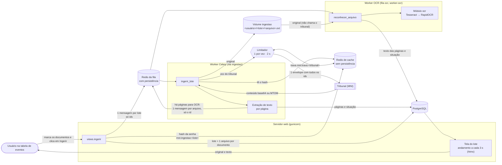
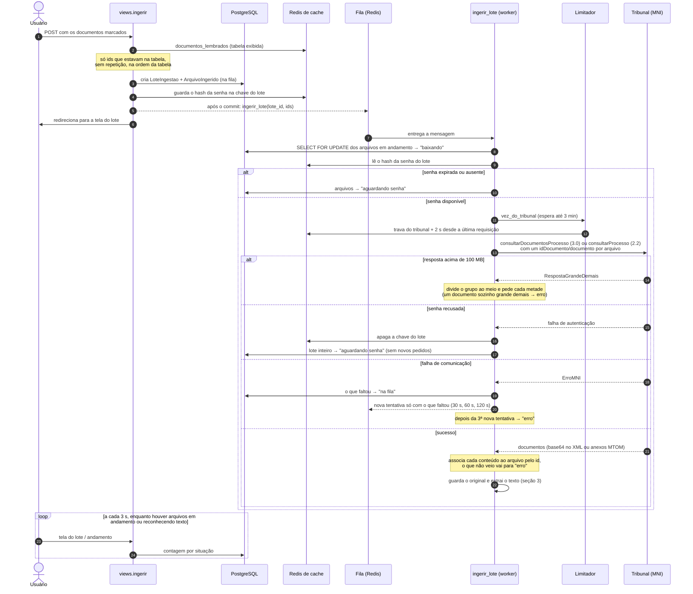
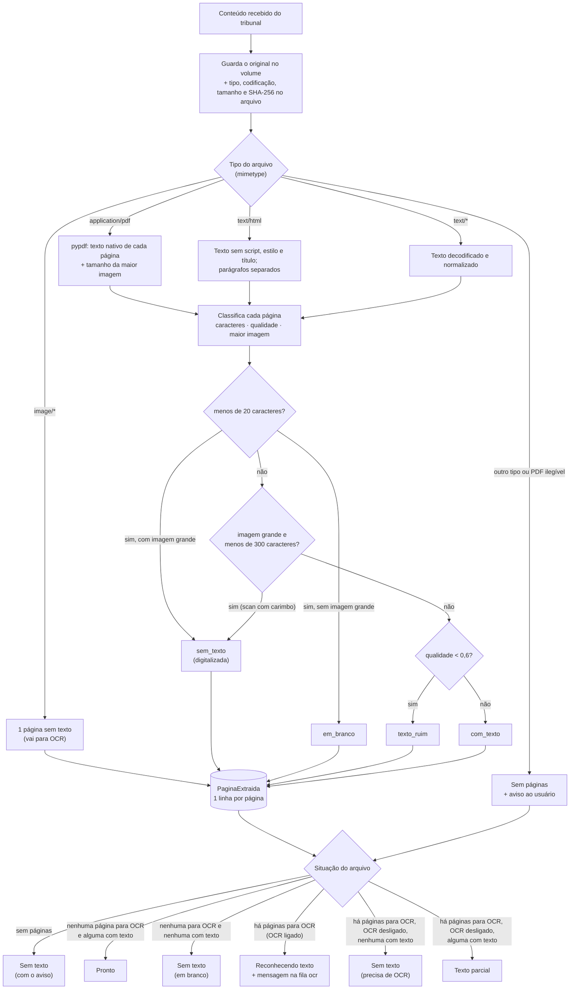
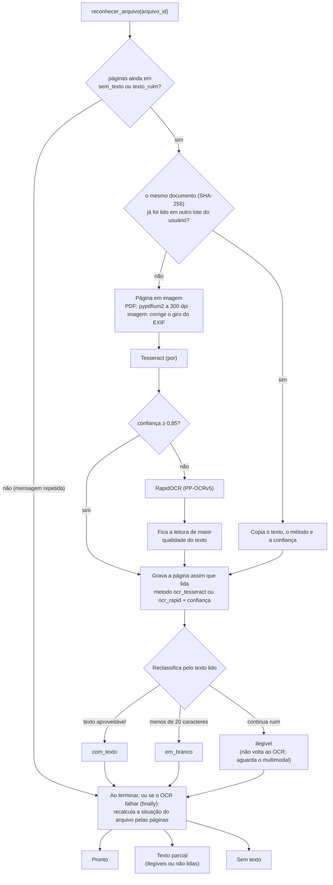
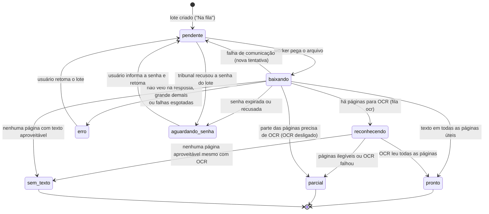
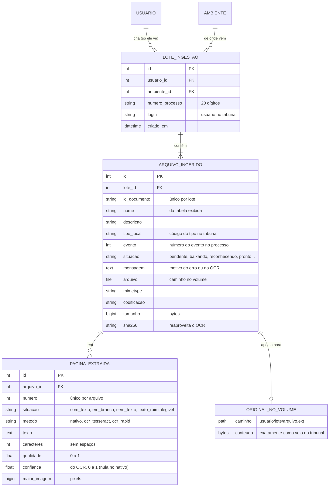

# Fluxo da ingestão de documentos

Como um documento sai do tribunal e vira texto guardado no EloJudicial: do clique em "Ingerir"
na tabela de eventos até as páginas extraídas no PostgreSQL, com o OCR das páginas digitalizadas.
As decisões por trás de cada etapa estão nos ADRs deste diretório (ver o [índice](README.md)).

Situação em 2026-11-27. Os diagramas usam [Mermaid](https://mermaid.js.org/), que o GitHub e o
VS Code exibem direto no Markdown.

## 1. Visão geral

## 2. Download: da criação do lote à resposta do tribunal

Um lote comum gera **uma única requisição** ao tribunal
([0017](0017-download-do-lote-numa-unica-requisicao.md)). Toda requisição passa pelo limitador
([0016](0016-uma-requisicao-por-vez-ao-tribunal.md)).

## 3. Extração: do original às páginas classificadas

Feita no worker logo depois do download, arquivo por arquivo
([0008](0008-extracao-de-texto-sem-ocr.md), [0013](0013-deteccao-de-texto-por-pagina.md)). As
páginas sem texto aproveitável (`sem_texto` e `texto_ruim`) seguem para o OCR (seção 4).

O OCR fica desligado (`INGESTAO_OCR=0`) nos testes e fora do Docker, onde os motores não estão
instalados.

Os limiares (20 e 300 caracteres, imagem grande a partir de 500 mil pixels, qualidade 0,6) são
provisórios: ficam em `Limiares` (`ingestao/extracao.py`) e são calibrados com
`estatisticas_extracao` e `reextrair` ([0014](0014-medicao-e-calibracao-dos-limiares.md)).
`reextrair` reprocessa os originais já guardados, sem consultar o tribunal.

## 4. OCR: das páginas digitalizadas ao texto

Feito no `worker-ocr`, uma tarefa por arquivo, a partir do original no volume
([0018](0018-ocr-em-modulo-e-worker-proprios.md), [0019](0019-motores-de-ocr-em-dois-niveis.md),
[0020](0020-situacao-reconhecendo-durante-o-ocr.md)). Não fala com o tribunal, então pode rodar em
paralelo (`OCR_CONCORRENCIA`, padrão 4).

A página é gravada logo depois de lida: se o worker cair no meio, a mensagem volta para a fila
(`acks_late`) e a tarefa continua das páginas que faltam. O limiar de 0,85 (`CONFIANCA_MINIMA_OCR`,
em `ingestao/tasks.py`) e a resolução de 300 dpi são provisórios.

## 5. Situações de um arquivo

"Na fila" e "baixando" contam como **em andamento**. A tarefa só pega arquivos nessas
situações, o que a torna idempotente: uma mensagem repetida não baixa de novo o que já terminou
([0006](0006-tarefas-longas-e-idempotencia.md)).

"Reconhecendo texto" fica fora do grupo em andamento, porque o arquivo já foi baixado, e também
fora dos concluídos. A tela do lote continua a consultar o andamento enquanto houver arquivos
nessa situação ([0020](0020-situacao-reconhecendo-durante-o-ocr.md)). Um arquivo preso nela (mensagem
perdida da fila `ocr`) volta à fila com `reextrair --situacao reconhecendo`.

## 6. Onde cada dado fica guardado

| Dado | Onde | Por quanto tempo |
|------|------|------------------|
| Lote, arquivos (metadados, situação, SHA-256) e páginas (texto e métricas) | PostgreSQL | Até o lote ser apagado |
| Original de cada arquivo | Volume `ingestao` (`INGESTAO_DIR`), em `<usuário>/<lote>/<arquivo>.<ext>` | Até o arquivo ser apagado: apagar o registro apaga o arquivo do volume |
| Hash da senha do tribunal para o lote (`mni:ingestao:<lote>`) | Redis de cache, sem persistência | `MNI_SENHA_TTL` (2 h); apagado se o tribunal recusar a senha ou o usuário sair |
| Trava e hora da última requisição ao tribunal (`mni:trava:<tribunal>`, `mni:ultima:<tribunal>`) | Redis de cache | Trava: até a requisição terminar (no máximo 5 min) |
| Mensagens das tarefas (`ingerir_lote(lote_id, ids)` na fila `ingestao`, `reconhecer_arquivo(arquivo_id)` na fila `ocr`) | Redis da fila, com persistência | Até a tarefa terminar; nunca levam senha nem conteúdo |
| Modelos do RapidOCR (PP-OCRv5) | Imagem `ocr` do Docker, baixados no build (`python -m ocr`) | Até a próxima imagem |

O **texto do arquivo inteiro** não é guardado à parte: é montado na hora, juntando o texto das
páginas em ordem, separadas por uma linha em branco (`ArquivoIngerido.texto`). A tela do lote
entrega o original (`/ingestao/arquivos/<id>/`) e o texto (`/ingestao/arquivos/<id>/texto/`),
sempre só para o dono do lote ([0009](0009-arquivos-pertencem-ao-usuario.md)).
